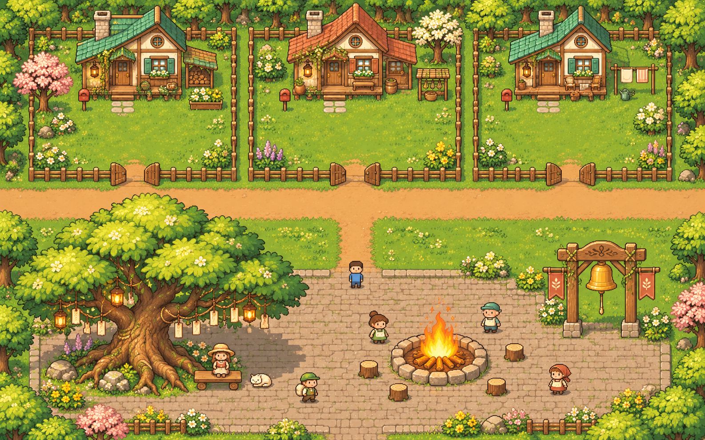

# 확장 가능한 마당·광장 배경

사용자가 승인한 배경 아트입니다. **마당은 위쪽, 마당 출입문은 남쪽, 길과 광장은 아래쪽**에 둡니다.
방 멤버 수에 맞춰 마당을 반복 배치합니다. 컨셉 그림 속 집 3개는 배치 예시이며 인원 제한이 아닙니다.



따뜻한 색감과 생활 소품의 밀도를 참고해 집·수호나무·종을 새로 구성했습니다.
특정 게임의 타일·건물·지도를 추출해 사용하지 않았습니다.
컨셉 그림의 주변 숲·꽃·소품이 모두 개별 PNG로 제공되는 것은 아닙니다. 실제 파일은 아래 목록을 기준으로 합니다.

## 게임용 파일

경로는 저장소 루트 기준입니다. [village-assets.json](../../public/assets/village-assets.json)에 28장 전체의 경로·크기·기준점·텍스처 이름을 적었습니다.
`file`은 `public/assets/` 기준이며 브라우저에서는 `/assets/`를 앞에 붙입니다.

| 경로 | 규격 | 내용 |
| --- | --- | --- |
| `public/assets/terrain/grass-01.png` ~ `grass-04.png` | 32×32 | 풀 4종, 꽃·클로버 포함 |
| `public/assets/terrain/dirt.png`, `stone.png` | 32×32 | 반복 흙길·돌바닥 |
| `public/assets/terrain/fence-h.png`, `fence-v.png`, `fence-corner.png` | 32×32 | 투명 울타리 |
| `public/assets/terrain/dirt-edge-*.png`, `dirt-corner-*.png` | 32×32 | 풀 위에 얹는 선택용 경계 8장 |
| `public/assets/objects/house-teal.png`, `house-clay.png` | 160×160 | 반복 배치하는 집 2종 |
| `public/assets/objects/guardian-tree.png` | 192×256 | 광장의 큰 수호나무 |
| `public/assets/objects/campfire-01.png`, `campfire-02.png` | 128×128 | 큰 모닥불 2프레임 |
| `public/assets/objects/cheering-bell.png` | 96×128 | 응원의 종 |
| `public/assets/characters/dough-soft.png`, `dough-grumpy.png`, `dough-monster.png` | 64×72 | 반죽 3단계, 고정 파일 이름 |
| `public/assets/characters/player-front.png`, `player-back.png` | 64×72 | 내 캐릭터 정면·뒷모습 |

바닥 6장은 불투명, 울타리·경계·사물·캐릭터는 투명도 0/255 PNG입니다.
캐릭터의 발바닥은 y=70이며 마지막 y=71행은 투명합니다.
바닥·울타리 타일은 좌상단 `(0, 0)`, 사물·캐릭터는 바닥 중심 `(0.5, 1)`이 기준입니다.
모닥불은 250ms마다 교체하고 반복합니다. 두 프레임의 y=62 이하 돌·장작은 같아서 바닥이 흔들리지 않습니다.

기존 임시 텍스처의 풀 이름 `grass-0`~`grass-3`은 새 파일 `grass-01`~`grass-04`와 대응합니다.
`pledge-tree`는 `guardian-tree.png`, `bell`은 `cheering-bell.png`, `player`는 `player-front.png`를 사용합니다.
기존 `campfire`는 첫 프레임에서 시작한 뒤 두 프레임을 반복하도록 연결합니다. 매니페스트에 대응 이름을 함께 적었습니다.

## 멤버 수에 따른 확장

[layout-template.json](layout-template.json)은 반복 마당 규격입니다. [expandable-layout.mjs](expandable-layout.mjs)는 이 규격으로 좌표를 만드는 실행 가능한 참고 자료이며, 앱에는 아직 연결되지 않았습니다.

- 마당 한 칸은 28×22타일, 좌우 배치 간격은 32타일입니다. 집 그림을 늘리지 않고 마당·집·울타리·길을 반복합니다.
- 슬롯을 가운데 `0`, 오른쪽 `1`, 왼쪽 `-1`, 오른쪽 `2`, 왼쪽 `-2` 순서로 추가합니다. 위아래 방향은 유지합니다.
- 방의 **전체 멤버**를 사용합니다. 접속 중인 사람만 쓰거나 친구 두 명으로 자르지 않습니다.
- 방별로 `userId → slot`을 보관합니다. 새 멤버가 들어오거나 목록 순서가 바뀌어도 기존 집 좌표는 바꾸지 않습니다. 퇴장 시에도 배정 기록은 보관하며, 재입장하면 같은 자리로 돌아옵니다.
- 같은 방의 모든 사용자가 같은 배정을 공유해야 합니다. 각자의 화면에서 자신을 0번 슬롯으로 다시 배치하지 않습니다. 내 캐릭터의 시작점과 카메라는 내 `userId`의 마당을 찾습니다.
- 광장과 수호나무·모닥불·종은 고정하고 좌우 길과 월드 범위만 확장합니다. 왼쪽 확장 시 음수 좌표가 생깁니다. 타일 배열을 쓸 때 인덱스는 `col - bounds.col`로 구합니다.
- 인원 상한은 규격에 두지 않습니다. 많은 마당을 한 장의 거대한 배경 이미지로 만들지 말고, 화면 주변의 타일과 사물을 구역별로 그립니다. 실제 성능은 화면 담당이 확인해야 합니다.

저장소 루트에서 참고 함수를 실행하는 예입니다.

```sh
node --input-type=module <<'JS'
import { createVillageLayout } from './design/village/expandable-layout.mjs';
const initial = createVillageLayout(['me', 'friend-a', 'friend-b']);
const expanded = createVillageLayout(
  ['me', 'friend-a', 'friend-b', 'friend-c', 'friend-d'],
  initial.assignments,
);
console.log(expanded.yards, expanded.bounds);
JS
```

이 참고 함수는 좌표만 만듭니다. 슬롯 배정의 DB 저장·동기화와 충돌·카메라·상호작용은 Claude가 실제 앱에 연결합니다.
퇴장한 멤버의 자리를 재사용하거나 재정렬하는 정책은 이 배경 작업에 포함하지 않았습니다.

## Claude에게 넘길 연결 작업

현재 `src/world/layout.ts`는 96×44 맵과 마당 3개가 고정되어 있고, `src/scenes/VillageScene.ts`는 두 옆집에만 친구를 그립니다.
**이번 커밋은 아트와 배치 참고 자료를 게시하며, 실제 게임의 고정 제한을 바꾸는 커밋은 아닙니다.**

1. 새 PNG를 로드하고 위 텍스처 대응을 적용합니다. 투명 울타리는 풀 바닥 위에 별도 층으로 올립니다. 반죽·플레이어 파일은 주민 `catalog.json`에 넣지 않습니다.
2. 고정 `YARDS`, 맵 크기, 두 옆집 순회를 전체 방 멤버의 마당 배치로 교체합니다. 방별 슬롯 배정은 모든 멤버가 일관되게 공유하도록 연결합니다.
3. 마당은 북쪽에 두고 남쪽 울타리에 폭 3타일 문을 냅니다. 집 입구에서 마당 문까지 길을 연결하고, 남쪽 큰길에서 광장으로 이어 줍니다.
4. 타일 원점·충돌 조회·이동 범위·카메라 범위를 확장된 `bounds`에 맞춥니다. 사물 앞뒤는 발밑 y값 기준으로 정렬합니다.
5. 큰 나무는 밑동, 집은 벽과 입구, 종은 기둥, 모닥불은 돌 테두리를 기준으로 충돌·상호작용을 잡습니다. 투명 여백이나 나뭇잎 전체를 막지 않습니다.
6. 모닥불의 기존 집중 인원별 크기 변화는 새 128×128 크기에 맞게 조정합니다. 인원 증가로 나무·종·통로를 덮지 않는지 확인합니다.

## 미리보기

- [전체 PNG 목록](previews/assets-overview.png)
- [실제 1배 크기 비교](previews/scale-comparison.png)
- [타일 반복 예시](previews/terrain-repeat.png)
- [모닥불 반복 GIF](previews/campfire.gif)

`design/village/`의 컨셉·미리보기는 검토용입니다. 게임에서는 `public/assets/`의 개별 PNG를 사용합니다.
