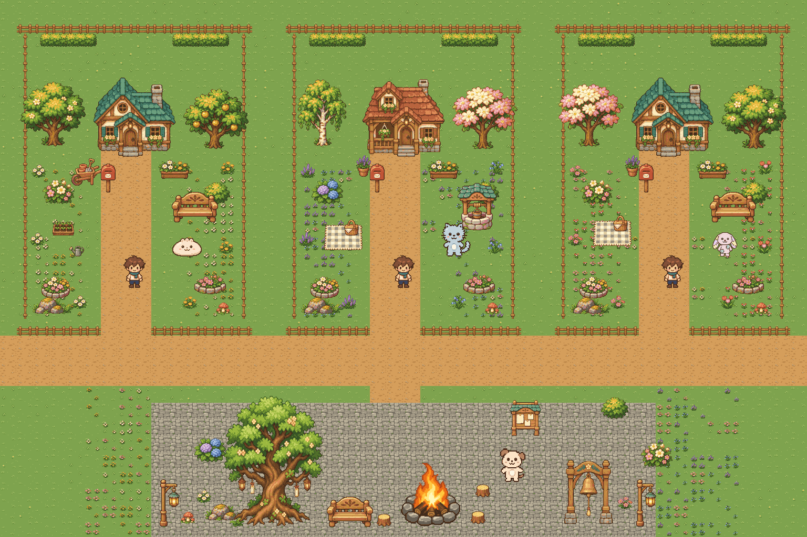

# 마을 꾸미기 추가 아트

사용자가 확인 후 커밋을 요청한 **장식 32장과 바닥 타일 16장**, 총 48장의 네이티브 PNG입니다.
기존 [마당·광장 배경](../README.md)의 풀 바닥·목재·돌·식물 색과 함께 쓰도록 정리했습니다.
이미지 생성 원본을 Python으로 분리·축소·색상 정리해 투명 PNG로 내보냈습니다.

## 파일과 규격

경로는 저장소 루트 기준입니다. 전체 파일·크기·기준점·텍스처 이름은 [decor-assets.json](../../../public/assets/decor-assets.json)에 있습니다.
`file`은 `public/assets/` 기준이며, 브라우저에서는 `/assets/`를 앞에 붙입니다. `texture_key`는 각 항목의 `id`와 같습니다.

| 구분 | 내용 | 개수 |
| --- | --- | --- |
| 나무 | 둥근 잎나무, 자작나무, 분홍 꽃나무, 금빛 열매나무 | 4 |
| 관목·숲 소품 | 동글 관목, 수국, 꽃관목, 생울타리, 고사리, 이삭풀, 버섯, 이끼 돌 | 8 |
| 꽃·원예 소품 | 데이지, 노랑꽃, 라벤더, 코스모스, 파란 종꽃, 튤립, 나무 화분, 토분, 돌 테두리 꽃밭, 둥근 꽃밭, 물뿌리개, 모종 상자 | 12 |
| 생활 소품 | 벤치, 우편함, 등불, 그루터기 의자, 우물, 게시판, 피크닉 돗자리, 손수레 | 8 |
| 바닥 | 꽃 6종의 듬성·풍성 버전, 혼합 들꽃 2종, 고사리 풀밭, 버섯 풀밭 | 16 |

- `public/assets/objects/decor-*.png`: 투명도 0/255 장식 PNG, 바닥 중심 `(0.5, 1)` 기준입니다. 마지막 행은 투명합니다.
- `public/assets/terrain/grass-*.png`: 추가 바닥은 모두 **32×32 불투명 PNG**, 좌상단 `(0, 0)` 기준입니다. 파일은 매니페스트 목록으로 구분합니다.
- 나무는 128×160 또는 96×160, 나머지 장식은 32×32~96×96 등 개별 규격입니다. 크기는 매니페스트를 따릅니다.
- 생울타리는 64×48 그림을 **48픽셀 간격**으로 겹치면 한 줄로 이어집니다. 벽 충돌은 별도로 연결합니다.
- 꽃 타일의 바깥 가장자리는 기존 풀 색 `(126, 163, 78)`이라 기존 풀과 섞어 놓을 수 있습니다.
- 자작나무의 흰 줄기와 밝은 꽃은 불투명한 색입니다. 흰색을 배경으로 간주해 지우지 않습니다.

## 배치 기준

**나무 + 낮은 관목 + 꽃 + 작은 돌**을 한 무리로 놓아 높이와 밀도를 다르게 만듭니다.
이런 무리를 모서리·울타리·집 주변에 배치하고, 마당 가운데는 주민 활동 공간으로 남깁니다.
넓은 마당에서는 장식 무리의 수를 늘립니다. 집과 작은 소품만 같은 비율로 확대하지 않습니다.

- 출입문과 중앙 길은 최소 3타일 폭으로 열어 둡니다. 나무·종·모닥불의 상호작용 지점에도 통로를 남깁니다.
- 꽃 타일을 전부 같은 확률로 뿌리기보다 마당마다 꽃 계열 1~2개를 정합니다. 기본 풀과 듬성·풍성 타일을 섞어 반복 무늬를 줄입니다.
- 햇살 정원: 데이지·노랑꽃·열매나무·모종 상자.
- 보라 숲 정원: 수국·라벤더·종꽃·자작나무·우물.
- 분홍 소풍 정원: 코스모스·튤립·꽃나무·피크닉 돗자리.
- 방과 마당 ID에 따른 고정 seed로 배치합니다. 매 프레임 장식을 무작위로 다시 배치하지 않습니다.
- 방 멤버 수가 늘어나면 기존 확장형 마당 템플릿에 장식 무리를 반복합니다. 예시의 마당 3개는 인원 제한이 아닙니다.

## 화면 연결

이번 커밋은 PNG와 배치 자료를 추가합니다. 실제 게임에 새 장식이 자동으로 배치되는 구현은 아닙니다.
Claude가 매니페스트를 읽어 텍스처를 로드하고 배치·충돌·깊이 정렬에 연결합니다.

- 주민이 아닌 배경 장식이므로 주민 `catalog.json`에는 넣지 않습니다.
- 타일과 낮은 풀·꽃·돗자리는 바닥 장식 층에 둡니다. `layer_hint`는 참고용이며 앱에서 자동 적용되지 않습니다.
- 나무·우물·우편함 등의 앞뒤는 발밑 y값으로 정렬합니다. 나뭇잎과 투명 여백 전체를 벽으로 막지 않습니다.
- 꽃과 풀은 통과할 수 있게 두고, 나무는 밑동·벤치는 앉는 면 등 실제 발밑 영역에 충돌을 둡니다.
- 사용자가 직접 배치하는 꾸미기 편집기와 보상·구매 규칙은 이 아트 묶음에 포함되지 않습니다.

## 미리보기와 배치 좌표

- [장식 PNG 32종 목록](previews/decor-catalog.png)
- [실제 타일을 3×3으로 반복한 16종 비교](previews/flower-tiles.png)
- [장식 전](previews/garden-before.png) · [장식 후](previews/garden-after.png)
- [전후 비교와 정원 색 조합](previews/before-after.png)
- [예시 화면의 파일과 발밑 좌표](example-placements.json)

예시는 실제 PNG를 조합한 **1536×1024의 작은 아트 배치 예시**입니다. 실제 방의 마당 크기나 전체 맵 규격이 아닙니다.
`example-placements.json`의 `source`는 기존 파일과 새 장식을 구분하는 참고 표시이며, 두 종류 모두 현재 저장소의 `public/assets/`에서 찾습니다.
집·수호나무·종·모닥불·주민·플레이어·기존 길과 울타리는 앞서 게시한 파일을 함께 사용합니다.
